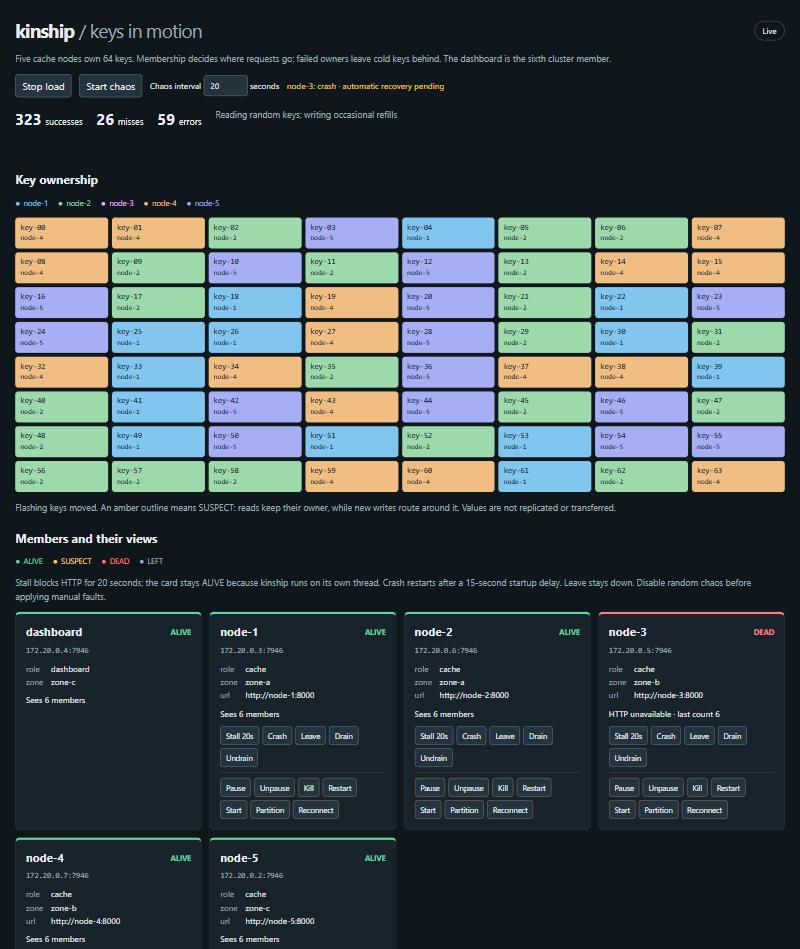
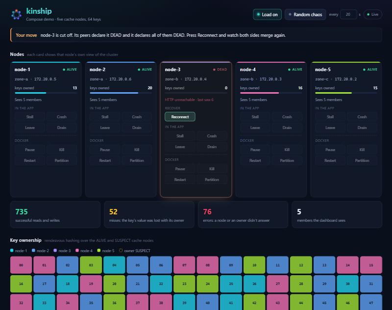

# Keys in motion: a kinship Compose demo

Five FastAPI cache nodes own 64 sample keys through `kinship.ring`. A sixth
node is a dashboard at <http://localhost:8080>: a card per node with its state,
its share of the keys and its own view of the cluster, a hint bar that says what
to watch, a key grid, a load generator and fault controls. Everything
updates through Server-Sent Events and plain JavaScript; there is no frontend
build step. Requires Docker with Compose, including Docker Desktop on Windows.

## Run

From this directory:

```sh
docker compose up --build -d
```

Open <http://localhost:8080>. The cache nodes wait 15 seconds on every startup
so crashes remain visible as DEAD before their automatic restart rejoins.
The dashboard starts at once and retries its seeds every 5 seconds
(`rejoin_interval=5`), so five green node cards and five owner colours appear a few
seconds after the nodes finish waiting.
Each worker builds its config inside `cluster_lifespan(config)`, with seeds
`node-1:7946`, `node-2:7946` and `node-3:7946`; losing one seed is harmless.
Metadata carries `role=cache`, a zone and `url=http://node-N:8000`.

The default image installs `kinship[fastapi]>=0.3` from PyPI on
`python:3.13-slim`, with uvicorn and httpx; the demo uses member epochs and
`Ring.fence()`, new in 0.3, so until 0.3 is published build from source. To try
changes in this checkout, build a release wheel from source, with maturin and
Rust 1.85.1 in a separate build stage:

```sh
KINSHIP_INSTALL=source docker compose up --build -d
```

In PowerShell, set `$env:KINSHIP_INSTALL = 'source'` first; remove it with
`Remove-Item Env:KINSHIP_INSTALL` to return to PyPI. Cargo registry, git and
target caches persist across builds. The context is the repo root; the
Dockerfile-specific `Dockerfile.dockerignore` excludes `.git`, `.venv` and
`target` directories, including nested ones, without changing the repo's root
ignore files.

## What the dashboard shows

Turn on **Load**. It warms the 64 keys once, then GETs random keys and
occasionally PUTs new values through random cache nodes. The receiving node
uses `get_ring(where={"role": "cache"})` and forwards to the owner. An owner's
metadata URL must match that node's expected URL; keys are quoted and a hop
limit bounds forwarding while views disagree. Writes use `new_work=True`.

- Key colours identify owners. Changed owners flash; only keys that actually
  moved flash. Hover a key to see its normal owner and its new-write owner.
- SUSPECT owners retain their keys and get a dashed amber outline, while new writes
  go to an ALIVE fallback. Reads still target the suspect owner.
- DEAD, LEFT and draining nodes own no keys. `ring.changes()` and `ring.moved()`
  drop values a node no longer owns. Draining also clears its own cache at once,
  since a node gets no membership event about its own metadata change.
- A node that was paused or cut off keeps its values, but meanwhile its peers
  suspected it or declared it dead and sent writes elsewhere. When it comes back
  it refutes by raising its incarnation, and on seeing that it drops its whole
  cache, so its returning keys read as misses rather than stale values.
- Each card shows when that node's current run started: its member epoch, the
  wall-clock time its process started. A restart shows as a new time, and the
  event log adds a **New run** entry after its MemberJoined.
- A write forwarded to a key's owner carries a fencing token, `ring.fence(key)`
  as the forwarding node sees it: the owner's name and epoch. The owner applies
  it only if its own `ring.fence(key)` agrees, so a write meant for its earlier
  run, from a peer that has not seen it restart yet, is refused with 409 and
  counted as **fenced**.
- Successes count successful GETs and PUTs. Misses are 404s from cold keys,
  including keys lost with an owner. Errors are requests the node answered but
  the key's owner did not, such as reads that still go to a SUSPECT owner.
  Unreachable counts requests to a node that did not answer at all. Like a
  client with a health check, the load generator skips nodes the dashboard
  already sees DEAD or LEFT, so these mostly come from the seconds before a
  failure is detected, and from stalls.
  Initial warming can also fail if you inject a fault before it finishes.
- **Sees N members** is polled from that node's `/cluster/members`. During a
  failure, counts can disagree. If its HTTP API cannot be reached, the card
  explicitly shows its last count as stale. DEAD and LEFT cards remain visible.
- The event log lists the newest first: membership events in blue, ring changes
  in violet, and fault, load and chaos actions in orange. History is bounded to
  200 timestamped entries.
  Browsers reconnect to a current snapshot. Restarting the dashboard clears
  counters/history; refreshing the page does not.

This is a **volatile cache**, without replication or key transfer. A new owner
starts cold, and restarting/undraining a node does not restore its old values.
Membership and ownership are eventually consistent, rather than a distributed
lock or a guarantee against concurrent writes during a partition.

## Try this

Turn on Load and let warming finish first. Use the buttons on `node-3`'s card;
the hint bar above the cards says what to watch, and the card offers the right
recovery button while the node needs one. Turn random chaos off before manual
faults, and recover one fault before starting another. Docker buttons require
the optional profile below.

| Fault / button | What to watch | Recovery |
| --- | --- | --- |
| **Stall** | The FastAPI event loop blocks with `time.sleep(20)`. HTTP calls time out and its member count becomes stale, but the card stays ALIVE and keys keep their owner: kinship runs on its own Rust thread. | Automatic after 20 seconds. |
| **Crash** | `os._exit(1)` sends no leave. Watch SUSPECT, DEAD, moved keys and misses, then MemberJoined when `restart: on-failure` starts it again, at a new epoch. | Automatic, including the 15-second startup delay. |
| **Bounce** | `os._exit(1)` too, but the next run skips the startup delay, so it is usually back, a few seconds later, before anyone declares it dead. Its later epoch replaces the old run on every node at once, though its incarnation starts again at 0: MemberLeft, MemberJoined and a New run entry, perhaps after a SUSPECT, with no DEAD. Its keys keep their owner but start cold, and with Load on, writes forwarded with the old run's token count as fenced. | Automatic, within a few seconds. |
| **Leave** | The node calls `leave()` and exits 0. Watch LEFT, moved keys and misses; Docker leaves it down. | **Start** with the chaos profile, or `docker compose start node-3`; the dashboard frees the fault slot once the node reports itself ALIVE. |
| **Drain** | Metadata changes to `role=draining`. The member stays ALIVE but its keys move to cache members. | **Undrain** returns `role=cache`; some keys move back, cold. |
| **Pause** | Docker freezes the entire process, including kinship's thread. Watch SUSPECT outlines, then DEAD and changed owners. | **Unpause**; wait for recovery/rejoin. |
| **Kill** | SIGKILL models a process crash. Watch failure detection and lost values. Docker counts a kill as a manual stop, so `restart: on-failure` leaves it down. | **Start**. |
| **Restart** | Docker stops and starts the process. A normal stop sends LEFT; values are lost and the node rejoins after the startup delay. | Automatic. |
| **Partition** | Disconnects only that cache node from the membership network. HTTP becomes unreachable; peers suspect and mark it DEAD, while it marks all of them DEAD. Keys move and errors/misses rise. | **Reconnect** restores its Docker DNS alias; it rejoins within seconds. Its own stale rumours can briefly flip a healthy member to SUSPECT or DEAD until that member refutes, so watch for a second, short RingChanged. |

A crash on `node-3`, seven seconds in: it is DEAD, its card shows its HTTP API
is gone, and its keys now belong to the other four nodes. The hint bar says
Docker will restart it, so the card offers no recovery button.



A partition of `node-3`: its peers and the dashboard now see 5 members, its
own count is stale because its HTTP API is out of reach, and its card offers
**Reconnect**.



**Random chaos** applies a random fault every configured interval (20 seconds
by default), holding at most one fault slot at a time. It waits for timer
recovery before taking another slot: unpause, start, reconnect or undrain;
stalls recover on their own. Recovery failures are logged and retried. Manual
faults block random faults until recovered; a starting worker retains its
fault slot until its HTTP API is ready. Turning it off also initiates
recovery; if a stall is still running, wait for it to finish. Without the
Docker helper, random chaos uses only stalls and drains, which can recover
without access to Docker.

## Opt-in Docker faults

```sh
docker compose --profile chaos up --build -d
```

The dashboard discovers the helper and reveals Pause/Unpause, Kill,
Restart/Start and Partition/Reconnect. The helper is on a separate internal
control network shared only with the dashboard; it has no published port.
Cache APIs, including in-process fault routes and `/cluster`, are only on
the Compose network. Only dashboard HTTP is published, on `127.0.0.1:8080`.

**The Docker socket gives root-level control over the host.** This is why it
is opt-in, for a disposable local demo, with a loopback-only dashboard.
The helper's allowlist reduces accidental reach: it accepts only the listed
actions and `node-1` through `node-5`, checks Compose container/network labels,
and uses the Docker HTTP API without passing input to a shell. It is not a
security boundary against a compromised helper or dashboard. Do not publish
the dashboard remotely or attach the helper to a production Docker daemon.
Because a loopback port is still reachable from any page open in your browser,
the dashboard only answers the `Host` names `localhost` and `127.0.0.1`
(against DNS rebinding) and refuses a control request whose `Origin` is
another site.

Membership uses `insecure_plaintext=True`, with a comment in `common.py`,
only for the isolated demo membership network. No `.env` key is required.

To turn the profile off, stop random chaos, recover any manual faults, then:

```sh
docker compose --profile chaos stop chaos
docker compose --profile chaos rm -f chaos
```

Docker buttons disappear after the next helper health check. Removing the
helper does not itself recover a paused or partitioned container.

## Tests and cleanup

The image includes standard-library unit tests for the fault allowlist,
Docker container/network scope, scheduler with a fake clock, safe forwarding,
ownership and eviction with a fake ring, and the SSE view:

```sh
docker compose run --rm --no-deps dashboard python -m unittest discover -s /app -v
```

Inspect services with `docker compose ps` and logs with `docker compose logs -f`.
To stop the demo, first turn random chaos off and recover manual faults (Unpause,
Reconnect, Start or Undrain). Then:

```sh
docker compose --profile chaos down
```

If a manual fault left the page unusable, `docker compose unpause node-3`
recovers a pause; for a partition, restore the membership network with
`docker network connect --alias node-3 kinship-demo_membership kinship-demo-node-3-1`.
Then bring the project down. No data volumes persist cache values.
